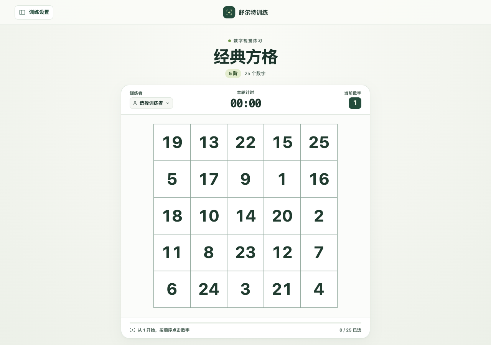
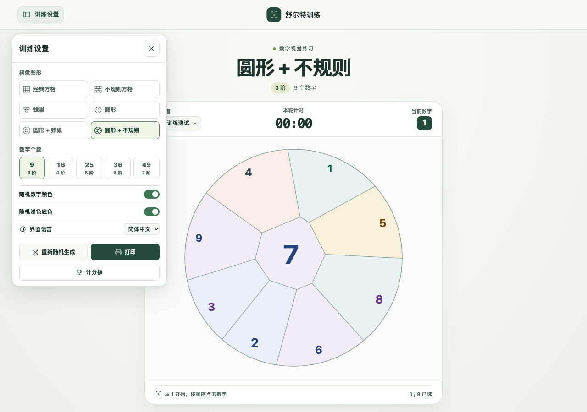
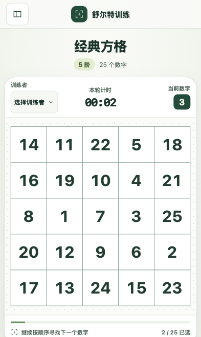
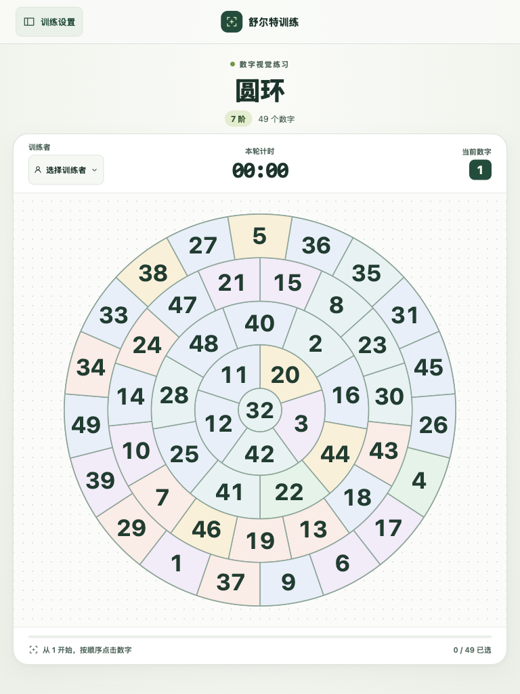

# Schulte Trainer

[简体中文](README.md)

A browser-based Schulte number trainer. Practice with a timer or print the current board on one sheet. Printing defaults to A4 portrait, and Chrome also offers A5 portrait.

## Screenshots

| Classic level 5 round in progress | Settings and level 7 irregular circle |
| --- | --- |
|  |  |

### Phones and iPad

In phone portrait mode, the board uses as much of the available width as possible. On short landscape screens, the timer and progress move to the left of the board. The board scales up on iPad when space allows. Tap the numbers directly and scroll the settings panel to reach more options.

| Phone portrait · Classic level 5 grid | iPad portrait · Level 7 rings |
| --- | --- |
|  |  |

## How to use

1. Open training settings in the upper left and pick a layout, level, and colors. Turn on “Mark selected numbers” to fade cells selected in order. The sidebar closes after about one second on page load. Move the pointer over it to cancel that automatic close.
2. Select a player in the top bar, or enter a name and press Enter to add one. Rounds without a selected player are saved under Guest.
3. Select the numbers in ascending order. The timer starts at 1. Selecting the final number plays a completion effect and saves the result.
4. Open the scoreboard from settings to see the player, date, layout, level, and elapsed time.
5. Choose Print or use the browser print shortcut. Printing defaults to A4 portrait. In Chrome, you can select A5 and keep the portrait layout. The worksheet keeps the current board arrangement and shows every number.

| Layout | Geometry |
| --- | --- |
| Classic grid | Equal-width, equal-height squares |
| Honeycomb | Offset hexagons |
| Irregular grid 1 | Quadrilaterals with shared edges and adaptive labels |
| Irregular grid 2 | Polygons with varying numbers of sides inside a square |
| Rings | Concentric sectors around a fixed center. With “Rotate rings” enabled, neighboring rings turn in opposite directions at different random speeds while the numbers stay upright |
| Irregular circle | Polygonal cells with labels centered by area inside a circle |

Every layout has levels 3–7 with 9, 16, 25, 36, or 49 numbers. The level denotes the number of cells in this app. Players, scores, and language preference are stored in the current browser's localStorage.

## Development

Use Node.js 20.19+ or 22.12+.

```sh
npm ci
npm run dev
npm test
npm run lint
npm run build
```

After running `npm run dev`, open the Local URL on your computer. On a phone or iPad connected to the same network, open the Network URL shown in the terminal.

The stack is Vite, React, TypeScript, Tailwind CSS, Jest, and Day.js. Deploy the production output in `dist/` to any static host.
