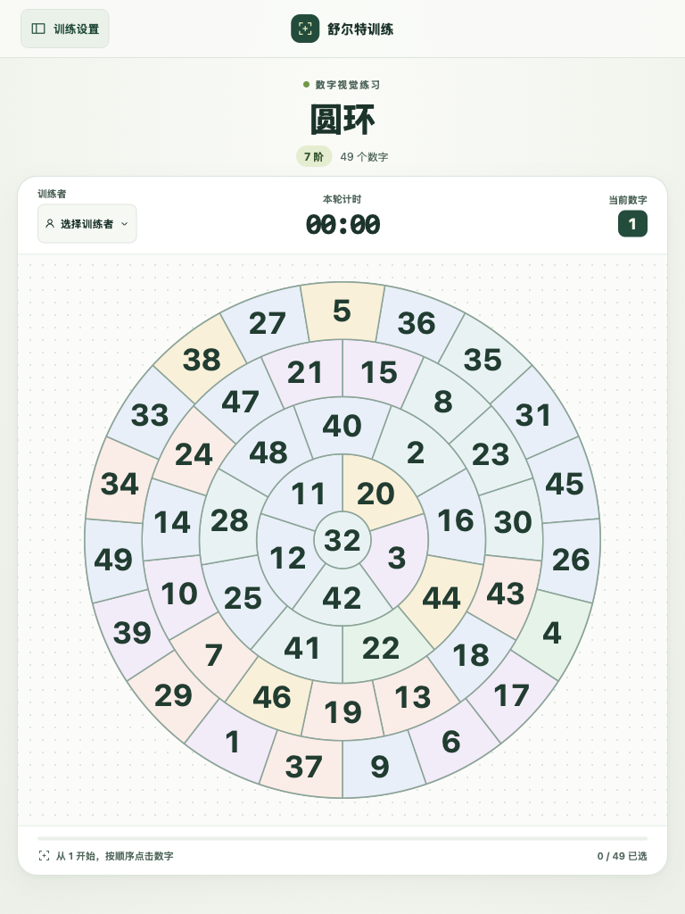

# 舒尔特训练

[English](README.en.md)

一个纯前端的舒尔特数字训练工具。可以在浏览器内计时练习，也可以把当前棋盘打印成单页练习纸。默认使用 A4 纵向，Chrome 打印对话框也可以选择 A5 纵向。

## 界面截图

| 经典五阶方格训练中 | 训练设置与七阶圆形不规则棋盘 |
| --- | --- |
|  |  |

### 手机和 iPad

手机竖屏时，棋盘会尽量占满可用宽度。手机横屏且可用高度较小时，计时和进度移到棋盘左侧。iPad 会根据可用空间放大棋盘。数字可以直接点按，设置侧栏可以上下滚动。

| 手机竖屏 · 经典五阶方格 | iPad 竖屏 · 七阶圆环 |
| --- | --- |
|  |  |

## 使用方法

1. 用左上角按钮打开训练设置，选择图形、等阶和配色。「标记已选数字」默认关闭，开启后会淡化已按顺序选中的格子。首次打开页面时，侧栏会在约一秒后收起，鼠标移入侧栏可取消这次自动收起。
2. 在顶栏选择训练者，或输入姓名并按 Enter 新增。未选择时以访客身份保存。
3. 按从小到大的顺序点击数字。点击 1 开始计时，点中最后一个数字后会显示完成特效，并自动保存成绩。
4. 从设置打开计分板，查看训练者、完成时间、图形、等阶和耗时。
5. 点击「打印」或使用浏览器的打印快捷键。默认使用 A4 纵向。使用 Chrome 时，可在打印对话框将纸张改为 A5 并保持纵向。打印版保留当前棋盘的数字分布，显示所有数字。

| 图形 | 布局 |
| --- | --- |
| 经典方格 | 等宽、等高的方格 |
| 蜂巢 | 交错排列的六边形 |
| 不规则方格 1 | 相邻四边形共用边，字号随格子大小调整 |
| 不规则方格 2 | 方形边界内拼接不同边数的多边形 |
| 圆环 | 静止中心和同心扇区。开启「旋转圆环」后，相邻圆环以不同的随机速度反向转动，数字保持直立 |
| 圆形不规则 | 圆形边界内的多边形，数字按格子面积重心定位 |

所有图形均提供 3–7 阶，对应 9、16、25、36、49 个数字。等阶表示本项目的题量。训练者、成绩和语言偏好保存在当前浏览器的 localStorage。

## 开发

需要 Node.js 20.19+ 或 22.12+。

```sh
npm ci
npm run dev
npm test
npm run lint
npm run build
```

项目使用 Vite、React、TypeScript、Tailwind CSS、Jest 和 Day.js。生产构建输出到 `dist/`，可部署到静态站点。
